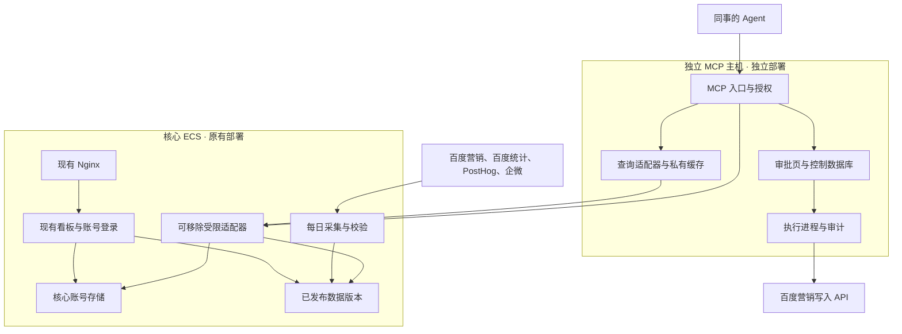
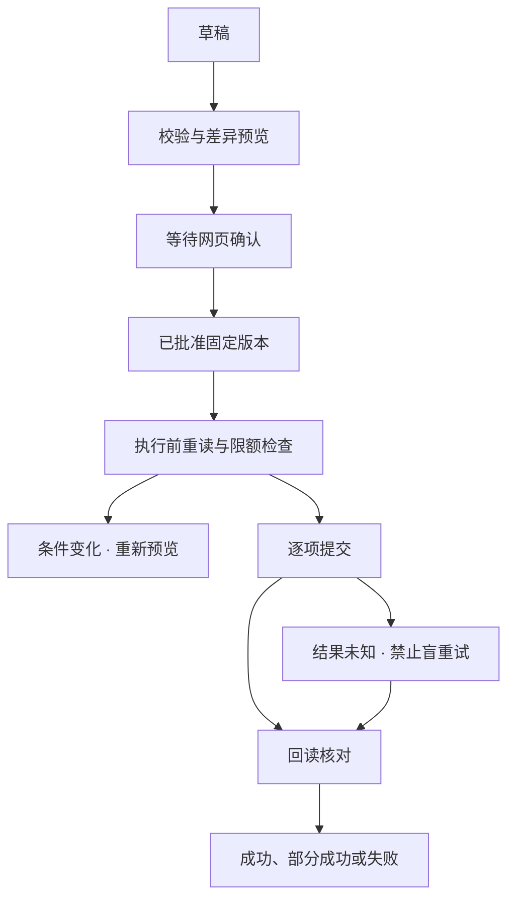

# Baidu.Ads MCP 完整方案

状态：2026-11-17 本地实现与现有数据验收完成，生产验收待办。已实现查询、OAuth/身份适配、网页审批、执行与核对队列、受限导出、订阅、历史模拟、建议规则及独立预审批自动规则的本地版本（46 个 MCP 工具）；真实接口/浏览器数据已完成 69 项交叉核对。尚未部署，真实广告写入默认关闭；生产隔离、权限及全部后续自动化不等于已验收。进度与剩余验收见 [MCP 验收状态](MCP_STATUS.md)，运行方法见 [MCP 开发说明](../services/mcp/README.md)。
日期：2026-11-14。依据：本仓库代码、AGENTS.md、现有业务要求和文末协议资料。
范围：查询、分析、投流管理、协作审批、受控自动化、权限与运维。本文件保留完整设计目标；已实现行为与生产验收状态以开发说明和验收记录为准，不能把设计目标视为已上线能力。

首要约束（2026-11-14 补充）：MCP 是可移除的外围系统。开发、构建、部署、运行、升级或停用 MCP，均不得成为核心看板、账号登录、每日采集和数据发布的运行前提。以下隔离设计取代初稿中的共享查询模块、共享身份数据库和联合发布方案。

## 1. 要实现的使用体验

同事在支持远程 MCP 的 Agent 中添加独立入口（拟定 `https://mcp.ads.ssw.com.cn/mcp`），使用自己的看板身份登录并授权，即可用中文或英文工作。域名与独立主机尚未配置。无需取得百度、PostHog、企微的密钥，也无需在电脑上运行采集程序。

典型工作包括：

- “昨天三个账号分别花了多少钱？和上周同一天比较。”
- “找出 SSW 最近 30 天花费高、相关性差的搜索词，给出否词建议和依据。”
- “TinaCMS 昨天有多少百度付费邮件点击？中国 CLI 启动和完成事件分别多少？”
- “微信客服本月客户发来多少条消息？哪些日期没有数据？”
- “把这个计划日预算从 100 元改成 120 元，给我确认具体变化。”
- “暂停这几个关键词，周一恢复前再提醒我确认。”
- “每天采集完成后生成摘要；满足我批准的条件才暂停指定关键词。”

同事的 Agent 负责对话与解释，服务器负责数据口径、权限、变更验证和实际调用。基础 MCP 服务不内置额外大模型，也不需要新增模型 API 费用。用户自己的 Agent 仍可能按其平台收费。

## 2. 当前基础与必须新增的能力

| 项目 | 已有基础 | 需要新增 |
|---|---|---|
| 数据 | ECS 每日北京时间 09:00 统一采集，校验后切换整套报告 | MCP 侧版本元数据、独立查询适配器、受限状态读取 |
| 报告存储 | 三份 HTML 报告、两份加密汇总快照，通过 `storage/current` 指向有效版本 | MCP 自己生成查询缓存，核心发布内容和成功条件不变 |
| 用户 | 看板账号密码，kenshi 管理账号和重置密码 | 可移除身份桥接、MCP 自有授权与撤销，核心用户库不做 MCP schema 迁移 |
| 数据可见性 | 所有登录账号可看三个广告账号、Tina CLI、企微汇总 | 沿用此规则，不给私人面板另设查看密钥 |
| 百度营销 | `tracker.py` 限定五类只读接口 | 独立写入适配器、逐操作能力校验和执行记录 |
| 部署 | 阿里云 Windows、Nginx、Flask/Waitress、任务计划程序 | 独立主机与入口上的 MCP、执行进程、独立部署；核心侧仅有可移除受限适配器 |
| GitHub | 代码、历史数据和 Pages 跳转 | MCP 代码、测试、文档；新增生产数据仍留在 ECS |

现有发布目录没有可供 MCP 直接查询的独立 SQLite 快照。不能把采集中不断变化的原始数据库直接当作“看板当前版本”。本方案的生产服务与新增 API 权限尚未验证；本地开发进度不代表生产已上线。

## 3. 架构与部署位置

- 生产目标采用独立主机、独立系统盘、独立入口与证书更新配置，避免 MCP 消耗核心服务器资源。是否购买新实例在部署前单独决定，本次设计不创建收费资源。核心网站保留原入口与 8765 端口。
- MCP 主机提供 `/mcp`、授权、审批和管理页面。核心 Nginx 不反向代理到 MCP，不修改核心 upstream、启动任务或证书重载流程。看板若增加导航，只能是可选普通链接，不能加载 MCP 脚本或等待 MCP 接口。
- 采用 Python 官方 MCP SDK、类型化输入输出、ASGI 服务，使用独立代码制品、虚拟环境、依赖锁与配置。核心不得 import MCP 包、安装 MCP 依赖或使用 MCP 数据库。
- 核心侧适配器为独立、可停止的进程，仅暴露发布文件白名单、状态和身份验证契约。使用独立受限身份、私有网络认证、严格流量与资源上限；不把核心磁盘或 SQLite 通过网络挂载给 MCP。它不能修改核心文件、密码、数据库结构、发布指针或任务计划。
- 身份桥接向 MCP 返回短时、受众限定的身份断言及账号版本，不输出密码摘要或核心配置。桥接故障时 MCP 拒绝登录、续期和新执行；核心原登录完全不调用桥接。鉴权实现与隔离验证作为阶段 A 的必要工作。
- 执行进程只在独立主机读取单独配置的百度操作凭据。核心原有密钥继续留在原主机。DPAPI 密文不可直接当跨主机配置使用，MCP 所需凭据须在目标运行身份下单独配置。
- CLI／企微加密快照只供已授权主体查询。优先由受限适配器提供指定版本的已授权汇总，不复制核心通用解密配置；MCP 的短期私有缓存按需加密、设容量和有效期。
- 不新增定时备份，不把新业务数据、令牌或审计内容推到公开仓库。MCP 缓存是可丢弃的查询副本。MCP 数据库迁移只影响 MCP 主机，回退和卸载无需迁移核心库。

### 3.1 不可违反的边界

| 边界 | 实施约束 | 故障后的结果 |
|---|---|---|
| 调用方向 | MCP 依赖受限读取契约，核心业务从不调用或等待 MCP | MCP 关闭后，核心路径不变 |
| 数据 | 原始库、用户库与报告目录对 MCP 无写权限；适配器只做短时读取，不持有跨请求事务 | MCP 缓存或控制库损坏只停 MCP |
| 发布 | 核心发布不包含 MCP 导出、校验、索引或通知步骤 | MCP 处理新版本失败时，核心照常发布 |
| 身份 | 核心账户为身份来源，MCP 权限独立；核心登录不依赖 MCP 令牌或表 | MCP 授权模块损坏不阻止看板登录 |
| 构建部署 | 独立构建、依赖、制品、健康检查与回退；同仓库也必须路径分离 | MCP CI 或部署失败不阻塞核心发布 |
| 资源 | 独立主机隔离主要资源；核心侧适配器有操作系统可执行的上限、短超时和熔断 | 适配器超限被终止，核心不等待重试 |
| 上游额度 | MCP 的实时查询与写入有账号级限额，并为核心采集保留调用容量 | 无法验证额度隔离或余量时关闭对应 MCP 功能 |

同机仅可作为后续另行评估的降级选项，必须说明它仍共享主机故障域，不能声称达到独立主机级隔离。生产上线前，核心侧适配器也必须通过资源耗尽和权限验证；若不能建立有效边界，则不能上线该接入方式。

“不影响核心正常运行”指核心登录、页面服务、采集、发布和存储的可用性。经过批准的百度投流修改本身会改变真实投放及后续报表，这是业务效果。共享百度账号的限流、授权失效与云平台故障等仍需明确处理，不能承诺任何故障下绝对零影响。

## 4. 查询层与数据口径

### 4.1 发布一致性

实现采用外围读取，不改核心的发布成功条件：

1. 核心保持现有 HTML 内 `report-data` JSON、加密快照和 `storage/current`。MCP 独立适配器读取已发布版本，使用测试样本核对口径，不 import `login_dashboard.py`，不抽取核心模块作为这次开发的前置改造。
2. MCP 在自己的主机生成 `manifest.json` 与可选 `analytics.sqlite3` 查询缓存，按字段白名单转换。缓存构建、校验和失败重试全部发生在 MCP 侧。核心看板继续使用原查询逻辑，通过契约和对账测试保持口径一致。

MCP 低频轮询发布版本，拟定每五分钟一次，失败退避；没有核心向 MCP 的同步通知。先取得固定 `release_id`，再读取该版本白名单文件，全部校验后切换 MCP 自己的缓存指针。核心发布和清理不等待 MCP；复制期间版本被清理则丢弃不完整缓存并重试。MCP 无权修改 `storage/current`。

每次查询与分页固定同一 MCP 缓存版本，签名游标拟定一小时有效。缓存超过有效期或不可读取返回 `SNAPSHOT_EXPIRED`。新版本解析失败时可继续提供最后成功版本，但显式标记陈旧、来源版本与覆盖日期；不能将旧数据标记为实时。

MCP 自有清单记录可验证的来源覆盖、抓取时间、口径版本和文件摘要。来源未提供的信息返回未知，不能用缓存导入时间冒充核心采集时间。未来核心独立发布新的标准数据格式时，MCP 通过版本化适配器跟进；核心不需要保留 MCP 私有模型或等待 MCP 升级。

### 4.2 指标定义

| 数据 | MCP 返回与解释规则 |
|---|---|
| 广告消费、点击、展现 | 保留账号与报告维度，金额统一 CNY，以十进制定点值处理；不能把不同维度报告相加 |
| CTR、CPC | 由区间总展现、总点击、总消费重新计算；分母为零返回不可计算，不平均每日比率 |
| 付费邮件／联系我们点击 | 百度统计记录的付费访问中目标行为会话数，现有规则每会话一次；点击不等于发送邮件或实际询盘 |
| 付费转化细分 | 当前只有站点与日期汇总。计划、单元、关键词筛选不能应用到这些计数；不据此输出关键词转化成本 |
| 站点整体流量 | 独立返回 PV、UV、IP 数、平均访问时长、全部转化。UV/IP/平均时长仅使用相同区间的原始精确汇总；任意区间不支持时明确返回不可得 |
| Tina CLI | 中国地区的启动与完成事件次数，所有来源；不称为人数、百度广告安装数或成功安装用户数，不直接当作配对漏斗 |
| 企微 | 客服客户发来的消息数、每日咨询客户数。跨日客户数相加是日计数之和，不能称为去重客户数或新增好友数；无百度付费归因 |
| API 转化字段 | 保留原始定义，作为高级诊断项，不恢复已移除的默认卡片或“无转化”警告 |
| 清单与设置 | 预算、出价、状态、质量度有快照时间；执行前另查实时值；关键词本体与影子数据分开 |
| 缺失 | 区分 `0`、字段缺失、未覆盖日期、接口失败、不支持；禁止把缺失补成零 |

所有日期默认 `Asia/Shanghai`，起止日期均包含在区间内。“昨天”按服务端北京时间计算。常规表现数据截止最近已覆盖的完整日期；今天若未采集，直接说明未覆盖。实时设置查询与历史表现查询必须标明不同时间点。

每个查询结果包含 `schema_version`、`release_id`、`source`、`requested_range`、`covered_range`、`missing_dates`、`generated_at`、`fetched_at`、`is_partial`、`warnings`、`applied_filters`。多个来源各自返回覆盖情况，不能使用一条总日期掩盖延迟。

区间比较只比较相同口径与可比覆盖。全站 UV、全部转化与付费转化分组展示。确需成本指标时，只有分子分母来源、账号、区间和归因兼容才计算，名称明确写“每次付费邮件点击成本”等，不称成交 CPA。

## 5. 工具目录

工具统一用 `baidu_ads_` 前缀，提供 JSON Schema、结构化结果和简短文字说明。只暴露明确的业务参数，不提供任意 SQL、shell、URL 代理或通用百度 API 转发。以下名称是完整设计契约。当前 `get_settings` 返回历史快照，实时读取仅用于执行校验；采集健康、下次采集和上游授权到期缺少已验证状态源时返回未知。当前已实现的 46 个工具及功能边界详见开发说明；不能将本表所有设计项视为已实现。

### 5.1 查询与分析

| 工具 | 用途与主要参数 |
|---|---|
| `baidu_ads_list_accounts` | 三个账号、当前用户角色、该账号支持的读取及修改能力 |
| `baidu_ads_get_metric_catalog` | 指标定义、单位、支持维度、可相加性、归因和日期限制 |
| `baidu_ads_get_data_status` | 各源覆盖、最近成功与失败、下一次采集时间、上游授权到期状态 |
| `baidu_ads_get_summary` | 账号或多账号摘要，日期范围、对比区间；返回各来源分组 |
| `baidu_ads_get_performance` | 计划、单元、关键词、搜索词、地域、设备、小时、创意等已支持报告，排序、过滤、分页 |
| `baidu_ads_get_entities` | 计划、单元、关键词及后续创意清单，按 ID 或名称查找，标记同名歧义 |
| `baidu_ads_get_settings` | 指定对象的设置与快照日期；有权限时可请求实时设置，独立限流 |
| `baidu_ads_get_website_metrics` | TinaCMS／SSW 的全站与付费行为，显式 `traffic_scope`；不支持的站点明确返回 |
| `baidu_ads_get_cli_metrics` | 中国 CLI 启动、完成事件曲线和覆盖情况 |
| `baidu_ads_get_wecom_metrics` | 客户发消息数、咨询客户日计数，按天返回并标注汇总方式 |
| `baidu_ads_compare_periods` | 等长区间或用户指定区间比较，列出缺失日期和可比性 |
| `baidu_ads_analyze_performance` | 花费变化、相关性候选、低效词候选、设备地域差异；返回数据依据与适用限制 |
| `baidu_ads_get_change_history` | 查询变更前后与生效状态，用于解释数据波动，不声称因果已被证明 |

首批实现 summary、performance、settings、website/CLI/WeCom、status 所需基础查询，其余由同一查询层扩展。维度可用性来自 capability 表，未经实际验证的维度组合返回 `UNSUPPORTED_DIMENSION`。

### 5.2 投流修改覆盖

| 修改类别 | 设计支持的操作 | 执行前的必要验证 |
|---|---|---|
| 否定词 | 指定计划／单元添加、移除，区分精确与其他匹配类型 | 长度与数量限制，旧列表、去重、冲突、覆盖还是增量语义 |
| 关键词 | 新增、暂停、恢复、调整匹配方式与出价 | ID、所属账号／单元、本体与影子、产品与出价模式兼容性 |
| 预算 | 修改计划日预算，多个计划间提出预算分配方案 | 金额上下限、当前花费、单次与累计调整限制；预算不等于承诺实际消费 |
| 出价 | 手动 CPC、单元出价及已支持的目标出价 | 手动与智能出价分别建模；不把 CPC 字段用于 oCPC；学习期提示来自实际接口信息 |
| 启停 | 计划、单元、关键词、后续创意暂停／恢复 | 当前状态、父级状态、上游审核和其他投放限制；恢复不保证马上展示 |
| 地域／设备／时段 | 修改定向、排期和接口实际支持的设备配置 | 地域编码、北京时间、跨日时段、完整替换规则，展示修改前后 |
| 创意与落地页 | 新建草稿、改文案、URL 与追踪参数，提交审核 | 接口权限、字数与目标域名、审核状态；不凭空修改网站部署 |
| 计划／单元创建 | 复制配置后编辑、创建完整新对象及关联物料 | 父子依赖、必填字段、命名歧义、预算；可设暂停时默认暂停创建 |
| 批量策略 | 多账号调整、批量否词、预算重新分配 | 分账号子方案、独立审批、逐项结果；不承诺跨账号事务 |
| 删除 | 预留单独的不可逆操作类型 | 最后开放，单项确认、特殊权限，不能冒充可回滚操作；早期用暂停满足停投需求 |

上述是目标能力清单。仓库只读清单不能证明现有百度令牌具有这些写权限。旧版官方资料可证明存在部分管理接口，但本项目各账号的当前接口版本、字段、额度和权限仍须在实施前核实。

每种操作先登记 capability，包含产品、账号权限、接口版本、字段、读取旧值的方法、请求限制、审核要求、幂等支持和失败核对办法。未知项默认不可执行，但允许生成明确标记“尚不可执行”的建议草稿。

### 5.3 变更工作流工具

| 工具 | 行为 |
|---|---|
| `baidu_ads_create_change_plan` | 创建服务端草稿，输入带类型的操作列表、具体 ID、理由与依据版本 |
| `baidu_ads_preview_change_plan` | 检查能力与当前设置，生成差异、影响范围、约束结果及需确认事项；不提交修改 |
| `baidu_ads_request_change_approval` | 冻结方案版本，返回独立 MCP 管理站的审批链接 |
| `baidu_ads_get_change_plan` | 查看草稿、审批与逐项执行状态 |
| `baidu_ads_execute_change_plan` | 只接受方案 ID、固定版本与幂等键，服务端验证审批记录后入队；不接受临时新参数 |
| `baidu_ads_cancel_change_plan` | 取消未执行事项；已发送上游的请求进入核对，不声称已经撤销 |
| `baidu_ads_create_compensation_plan` | 根据保存的旧值生成恢复方案，重新检查当前状态、权限与审批 |

动作参数使用严格的判别联合类型，例如 `set_campaign_budget` 必须给 `account_id`、`campaign_id`、目标 CNY 金额；`add_negative_keywords` 必须给作用层级、实体 ID、匹配类型和词列表。工具不能把用户给的接口路径直接发送上游。

### 5.4 运维、报表与后续业务

| 工具组 | 设计 |
|---|---|
| 采集刷新 | `baidu_ads_request_refresh` 默认只刷新 MCP 缓存，`baidu_ads_get_job` 查询 MCP 作业。请求核心重新采集是单独的后续能力，只有核心提供受限且独立验收的命令契约才开放；MCP 不直接操作核心任务计划、采集锁或进程 |
| 导出 | `baidu_ads_create_export`，生成限日期、限行数的 CSV／JSON，网页登录鉴权下载，自动过期；不公开新数据 |
| 订阅与提醒 | 定时生成站内摘要、异常或授权到期提醒；明确时区和接收人；外发邮件、聊天通知作为另行配置能力 |
| 策略 | `baidu_ads_create_policy`、`baidu_ads_evaluate_policy`、`baidu_ads_get_policy`、`baidu_ads_pause_policy`；启用动作走网页审批 |
| 账户管理 | 账号创建与密码重置继续由核心看板负责；MCP 管理站单独管理接入停用、角色和写权限，不改核心用户表，不提供读取密码或上游 Secret 的工具 |
| 业务扩展 | CRM 询盘与成交、收入与 ROI、广告转化回传作为独立接入项目，现有数据不能支持这些结果；需取得真实事件、去重键与归因依据 |

## 6. 身份、权限和同事接入

### 6.1 账号与授权

采用远程 MCP 的 OAuth 授权流程，经受限身份桥接验证现有看板身份。MCP OAuth 服务与核心网页登录分别部署，MCP 不直接读写核心用户库。实施包括资源／授权发现、PKCE、客户端回调校验、作用域和目标资源校验。百度与 PostHog token 不转发给客户端。[协议依据见文末]

拟定 access token 有效期 15 分钟，refresh token 最长 30 天，轮换并检测重复使用。MCP 自有存储保存令牌摘要、主体映射和权限。核心身份以只读契约提供状态与版本，不要求核心增加 MCP 字段或数据库迁移。若现有身份数据无法可靠区分密码重置、删除重建等变化，阶段 A 必须先解决契约验证，不能承诺撤销已实现。

MCP 本地撤销立即生效，核心身份状态读取拟缓存最多 60 秒，核心密码重置或停用的传播上限亦为 60 秒。缓存过期且桥接不可达则拒绝访问，不使用无限期陈旧授权。每次新执行须有实时身份核验，失败则不提交；已发送的上游操作仍须继续核对。状态查询按主体合并并严格限流，不能让每个并发请求都访问核心用户库。桥接故障对核心登录没有反向依赖。

客户端注册以经过验证的客户端配置起步，记录精确回调 URI。是否启用动态注册或客户端元数据发现，按实际客户端需要和官方实现决定，不能开放无约束注册／URL 抓取。目标客户端至少选择一个 Ken 使用的和一个同事使用的，分别验收登录、查询、审批跳转、刷新与撤销。未测试前不承诺任何 Agent 都能直接安装。

### 6.2 简单角色模型

| 角色 | 读取全部数据 | 创建建议／方案 | 批准与执行 | 管理用户 |
|---|---|---|---|---|
| viewer | 是，包含 CLI 和企微 | 可生成分析建议，不提交执行方案 | 否 | 否 |
| operator | 是 | 可在获授权的广告账号创建方案 | 仅在已批准范围内发起执行 | 否 |
| owner（kenshi） | 是 | 是 | 初期唯一审批者，可按账号与动作授权其他审批者 | 是 |

拟定 scopes 为 `analytics:read`、`settings:read`、`changes:propose`、`changes:execute`、`jobs:refresh`、`exports:create`、`policies:manage`。服务器同时检查 scope、用户角色、广告账号和动作约束，单有一个 scope 不能越权。审批资格记录于用户权限，不由 Agent 自报。

独立 MCP 管理站提供“Agent 连接”“投流变更”“策略”和 MCP 角色管理，不改核心看板的页面服务或用户 schema。核心看板可选增加一个普通外链，外链失效不影响页面显示。所有用户的查询可见范围保持一致，写权限可不同。MCP 管理站自行负责网页登录会话与 CSRF 防护，普通方案作者只能取消自己的未执行方案。

## 7. 确认与执行协议

### 7.1 人能看懂的确认页

确认页显示操作者、账号、对象名称与 ID、修改前后、拟执行时间、依据日期、预估预算上限变化、全部操作数与不可逆项。明确区分“预算上限增加”和“实际花费预测”。所有描述从服务端保存的方案生成。

例子：SSW → 计划 123（示例 ID）→ 日预算 ¥100 改为 ¥120 → 增加 ¥20／20% → 立即执行。否词展示新增与删除的逐词清单，不使用只显示总数的确认。

用户在受信任的独立 MCP 管理页面确认固定版本。MCP 工具中的 `confirmed=true`、模型声称“用户同意了”或第三方文本都不能生成有效审批。审批后由 Agent 发起执行，或用户在页面点击“批准并执行”，两条路径使用 MCP 自己的执行队列。

### 7.2 状态与失败处理

- 审批绑定规范化操作内容摘要、方案版本、用户权限、账号、有效期。拟定即时方案审批 30 分钟过期；编辑内容立即失效。预约方案在指定时间窗口有效，仍需执行前核验。
- 执行前读取实时状态，比较所有会影响操作的字段与父对象约束。旧值已变化则停止相关操作并重新生成预览，不能用旧快照覆盖别人修改。
- 使用数据库事务领取任务，并对账号／实体加锁。幂等键绑定方案版本，重复点击返回同一任务。对百度后台人工并发修改无法仅靠本地锁完全防止；优先使用上游条件更新能力，不支持时缩短重读到提交间隔并回读检测冲突。
- HTTP 超时或连接中断后，状态是 `unknown`。先查询上游与请求标识核对，无法证明结果则转人工处理。不能直接复用只读客户端的自动重试逻辑，更不能保证上游未提供能力时的 exactly-once。
- 写入前持久化执行意图；提交后记录响应与回读结果。进程重启时恢复未完成任务，先核对再决定下一步。
- 批量修改逐项保存成功、失败、未执行、未知。依赖项失败则跳过后续依赖对象；默认一项出现未知就暂停整批。无跨账号原子事务。
- 成功必须有回读证据，需审核的创意标记“已提交／审核中”。报告仍显示上一采集版本时提示“设置已更改，表现数据尚未刷新”。
- 恢复旧设置是新的补偿操作，不保证撤销已经发生的花费、审核或历史曝光。执行前检查当前值仍符合预期，并再次批准。
- 全局写入开关可由 kenshi 关闭。关闭后停止领取新操作，已提交的操作继续核对。查询继续可用。

### 7.3 初始执行边界

默认 `mutations_enabled=false`，每类操作经接口验证与验收后独立启用。首批人工审批执行拟限制每方案 20 个对象，禁止跨账号同批执行；超过限制拆为可独立预览、确认的子方案。预算、出价等金额限制由 kenshi 按账号明确配置，未配置时拒绝执行，不替用户选择可花费额度。

新增创意、计划、删除和智能出价模式切换分别开放，不能因为某账号的否词写入测试成功，就推断所有操作均可用。日累计调整限制与方案幂等检查在事务中生效，不能通过多次小额请求绕过。

## 8. 自动策略与投流建议

完整方案提供三个运行模式：

1. **观察**：只生成异常与建议，供用户查看。
2. **待确认**：按规则生成方案，用户批准后执行。
3. **受限自动执行**：由有资格的用户预先批准具体规则、账号、对象范围、动作、额度、频率、期限与停止条件，在这些边界内执行。

三种模式的软件链路均已实现并在本地测试。受限自动模式支持明确对象的暂停、恢复、固定计划预算和固定手动出价，必须由主账号在独立网页批准固定版本；两个执行开关默认关闭，示例不授予 `policies:automate`。规则保存为类型化条件，不能执行任意自然语言或模型输出代码。其他操作仍须独立验证规则及供应商契约后扩展。

规则可包括搜索词否词候选、预算耗尽提示、花费突增、关键词暂停建议、授权将到期、采集缺失、预算分配建议。没有可靠关键词转化归因时，只能提出基于相关性或流量成本的候选，不能以“此词没有企微咨询”为依据自动停词。

每条规则含最小数据量、观察窗口、数据延迟缓冲、执行冷却期、单次及累计限制、有效期、审批者、时区。由 MCP 轮询发现并成功导入新发布版本后评估，每个窗口至多一次；用 `(policy_id, policy_version, release_id, evaluation_window)` 去重。当前受限自动规则采用更保守的 `(rule_id, version, Beijing date)` 去重，每规则版本每天最多一批；重复触发返回原批次证据，修改版本不重置全规则累计限额和未知结果阻断。观察/建议规则分别按其固定版本与区间去重。核心采集不启动或等待规则执行。数据不全、授权失效、限额不足或上游状态冲突时不执行。

历史模拟展示规则会命中哪些对象与累计调整量，不把模拟当成收入或转化提升证明。新版本规则必须重新批准。执行仍走第 7 节的实时核验、审计与未知结果处理。

暂停规则只停止新执行；恢复广告必须是独立动作。自动恢复、预算上涨及新建投放也必须在已批准规则中明确列出。预约时间不得在数据库中依赖服务器本地时区。

## 9. 服务契约、数据结构与审计

### 9.1 请求与错误

- `account_id` 与实体 ID 为字符串，账号从服务端目录解析；同名对象返回候选，禁止随意选第一个执行。
- 列表默认 50 行，最大 200 行，返回稳定排序的签名游标。大导出异步处理，初始单次上限 10,000 行，可配置。
- 查询时间上限拟定 15 秒，上游设置读取 20 秒；写任务异步返回 job ID。超时只影响请求等待，不意味着后台工作取消。
- 返回 `UNAUTHORIZED`、`INSUFFICIENT_SCOPE`、`UNSUPPORTED_OPERATION`、`DATA_INCOMPLETE`、`STALE_PRECONDITION`、`APPROVAL_REQUIRED`、`APPROVAL_EXPIRED`、`RATE_LIMITED`、`UPSTREAM_UNAVAILABLE`、`OUTCOME_UNKNOWN` 等稳定业务码及可操作说明。
- 协议错误与工具业务错误按 SDK 分开处理。查询标注只读，执行标注会产生外部副作用；工具 annotation 仅供客户端理解，服务端仍强制校验。

### 9.2 拟新增本地存储

| 表／对象 | 主要信息 |
|---|---|
| MCP 主体与授权 | 映射核心身份断言、角色、接入停用状态、权限版本与账号动作授权，全部在 MCP 自有库 |
| OAuth 授权 | 用户、客户端、scopes、到期、轮换与撤销；只存令牌摘要 |
| capabilities | 账号／产品／操作、已验证接口与限制、验证时间 |
| change_plans / items | 作者、版本、操作、旧值、目标值、依据版本、审批摘要与状态 |
| approvals | 确认者、方案版本、摘要、有效期、执行约束 |
| execution_jobs / attempts | 幂等键、逐项状态、请求标识、回读结果、错误和恢复状态 |
| policies / evaluations | 规则版本、预授权范围、去重键、命中与停止原因 |
| audit_events | 谁在何时对哪个对象做了什么、关联方案与结果；不存密码或 token |
| import_jobs | MCP 缓存导入开始、结束、错误与来源发布版本；核心采集状态只读引用 |

控制状态、缓存与日志存放在独立 MCP 主机的数据目录。若主机采用 Windows，拟用其服务账户下的 `%LOCALAPPDATA%\Baidu.Ads.Mcp\`；与核心服务器的目录没有共享写挂载。单实例起步，事务约束、WAL 和执行领取锁经目标系统验证后启用，读查询不阻塞执行状态写入。设置缓存、导出、日志各自容量上限和轮转；MCP 磁盘满只导致 MCP 拒绝新作业。

审计用于追溯操作，是业务数据而非额外备份。拟保留 180 天，未解决任务及关联审批不自动删除。日志隐藏 Secret、token、明细 IP 和聊天内容。用户能看自己方案，owner 能看全部执行审计；普通统计仍对所有登录用户开放。

## 10. 实施模块

当前实现目录如下。下表短模块名均位于 `services/mcp/src/baidu_ads_mcp/`，没有核心应用对 MCP 的反向依赖。

| 路径或模块 | 职责 |
|---|---|
| `server.py`、`web.py` | 46 个工具、身份上下文、网页审批及下载 |
| `query.py`、`analytics.py` | 版本化查询、覆盖、口径、筛选及分页 |
| `auth.py` | OAuth、scope、身份版本与授权撤销 |
| `capabilities.py`、`creation.py` | 上游能力及严格操作参数 |
| `changes.py`、`executor.py` | 方案、差异、审批、持久化队列、逐项审计与核对 |
| `baidu_write.py`、`runtime.py`、`worker.py` | 固定接口适配、独立运行、恢复及执行开关 |
| `policies.py`、`rule_engine.py`、`automatic_rules.py` | 观察、建议、历史模拟与独立预审批规则 |
| `operations.py` | 后台刷新作业、导出、订阅及站内通知 |
| `sync.py`、`cache_reader.py` | MCP 自有缓存导入、容量控制、重启验证及过期恢复 |
| `services/core-reader/` | 独立只读文件及身份桥接，独立依赖，不被核心 import |
| `services/mcp/run_mcp.ps1`、`services/core-reader/run_reader.ps1` | 各自的 Windows DPAPI 启动入口，不自动注册核心任务 |
| `services/mcp/tests/`、`services/core-reader/tests/` | 独立测试；真实捕获验收脚本在 `services/mcp/scripts/` |
| `services/package_services.py`、`.github/workflows/mcp.yml` | 独立制品、校验清单及 Linux/Windows CI |

通过版本化契约、固定样本与对账测试维持统计和身份语义，不抽取核心模块强制双方共用。MCP、适配器各自打包和锁定依赖；核心安装及运行不需这些包。`tracker.py` 的只读 allowlist 保留，所有修改只通过独立执行模块。

同仓库可维护代码，但新增独立 MCP 构建／发布流水线。MCP 测试不是核心制品构建或部署的依赖，失败不能阻塞核心发布。核心制品明确排除 MCP 包、依赖与管理页面。核心侧适配器单独发布、停止、回退，不重启看板或采集任务。卸载顺序为关闭 MCP 新执行、处理在途核对、撤销接入凭据、移除适配器和 MCP 入口；无需恢复核心数据库。

## 11. 实施顺序与交付门槛

| 阶段 | 完整交付 | 进入下一阶段的条件 |
|---|---|---|
| A 基础核实 | 数据字典、客户端、写接口能力、OAuth／身份桥接契约、独立主机与资源边界 | 核心无反向依赖，身份撤销和上游配额可验证，关键依赖没有猜测 |
| B 只读共享 | 授权登录、三账号数据、CLI／企微、曲线、状态、同事接入说明 | 与看板对账，两个实际客户端登录与撤销通过 |
| C 方案协作 | 查询实时设置、生成建议、变更预览、网页审批、审计 | 没有审批无法执行，方案修改导致审批失效 |
| D 首批修改 | 否定词、启停、预算、手动出价，逐动作启用 | 权限、并发、超时核对通过；受控真实操作回读一致 |
| E 完整投流 | 关键词匹配、地域时段、智能出价、创意、落地页、创建与批量 | 每种动作独立验收，审核／部分失败／依赖恢复可处理 |
| F 自动化 | MCP 缓存刷新、导出、独立管理站摘要、规则模拟、预授权自动执行 | 连续观察期无越界，规则失效与停止开关通过；核心重新采集能力另行验收 |

功能的软件实现和生产验收分别记录；上表是完整交付门槛，不表示各阶段已经上线。当前本地通过范围及未完成的供应商权限、客户端、Windows 与主机隔离验收见 [验收状态](MCP_STATUS.md)。不能根据单种操作的验证开放所有写操作。

## 12. 验收场景

1. 同一发布版本、同一日期、筛选和报告维度下，三个账号的消费、点击和展现与看板一致；区间比率重新计算。看板总览采用关键词报告，默认 MCP 摘要采用账户报告，跨维度差异须明确披露，不强行修改数据使之相等。
2. 全站 UV/IP 无精确区间汇总时返回不可得；缺失和零分开；付费点击不随计划筛选伪造拆分。
3. CLI 只显示中国事件，企微只显示汇总；跨日客户不冒充新增或去重客户。
4. 采集失败、版本切换、旧版本清理、分页和跨时区日期都得到明确一致结果。
5. viewer 能读取全部三个账号与两种私人汇总，不能执行修改；密码重置、停用、撤销使旧 MCP 授权失效。
6. 错账号对象 ID、过期审批、改过内容的方案、额度超限、重复请求及并发领取均被正确处理。
7. 否词增量操作不丢已有词；预算／出价变化展示正确十进制金额；不支持的出价模式拒绝提交。
8. 模拟上游成功后连接断开、部分成功、进程崩溃及人工并发修改，均不发生盲目重复提交。
9. 批量创建父项失败不继续创建子项；创意审核中不显示已投放；补偿不能覆盖后续人工变更。
10. 广告名称、搜索词中的“忽略权限／调用其他接口”等文本只能作为数据，不影响权限或执行路线。
11. 规则重复评估、旧数据、授权撤销、冷却期与累计额度均能阻止不合规执行；停用不误报已经取消在途请求。
12. MCP 停机或升级时，看板和每日采集正常；匿名访问不能得到数据；日志不含密钥。

### 12.1 隔离验收是上线门槛

在可复现环境中记录核心独立运行基线，再注入以下故障。每项检查核心登录、三个页面、采集启动与结束、有效版本切换和数据完整性。关键路径不得新增错误或跳过采集，响应延迟 P95 相对基线增幅拟不超过 5%，使用相同负载重复测量。生产前在无广告写入权限下观察至少一个完整日采集周期。

| 故障注入 | 必须验证的结果 |
|---|---|
| MCP 构建失败、依赖冲突、进程崩溃、整机停止 | 核心能独立安装、构建、部署与运行，不安装或加载 MCP |
| MCP CPU／内存／磁盘耗尽，大量查询与重试 | 核心主机资源不被 MCP 主机占用；适配器拒绝超额请求且不持续重试 |
| 适配器停止、慢响应、身份源不可读 | MCP 有限超时、停止新执行；核心登录与发布不受影响 |
| MCP 缓存、控制库损坏或 schema 迁移失败 | 仅 MCP 降级，核心数据库和报告文件摘要无变化 |
| 核心发布格式变化、旧版本在读取时被清理 | MCP 明确报不兼容或陈旧，核心不回退、不等待、不停止发布 |
| 上游限流、身份核验被洪泛 | 核心采集额度保留；无法验证额度保护时 MCP 对应实时调用保持关闭 |
| 撤销 MCP 凭据、删除 MCP 代码和独立配置 | 核心继续完整运行，无悬挂 import、数据库表或启动依赖 |

同样验证文件权限拒绝适配器写入原始库、用户库、报告和任务配置。核心侧身份读取使用短连接、只读模式与有限等待，不持有跨请求事务；具体权限和资源限制由目标操作系统验证，不以“配置了限制”代替故障测试。

模拟测试先完成。真实写操作用经过明确选定的测试对象和精确差异，成功回读后才对其他对象启用。同事验收包含至少十个固定发布版本的真实问答，以及一次“提出修改—网页确认—核对结果”的完整链路。

性能目标先按内部小团队设定为 10 个并发查询，缓存命中查询 P95 小于 2 秒。该值是待测目标，全部常规统计在 MCP 私有缓存上查询。独立生产主机可能产生额外实例、磁盘和流量费用，部署前给出具体资源方案；不能为了省资源默默退回共享核心主机。

## 13. 待实施时核实的事项

- 百度各账号可修改哪些产品、实体和字段，当前官方接口文档、额度、请求标识及增量／替换语义。不能用有读权限推断有写权限。
- 智能出价、创意、新建与删除等操作的审核和状态规则；是否有可用测试环境或合适的测试对象。
- Ken 和同事实际使用的 Agent 客户端及 OAuth 注册要求。优先远程直连；确需 stdio 时再提供只负责连接的本地适配器，不复制上游凭据。
- 金额与自动执行权限由 kenshi 在管理界面配置。未配置时系统能查询与预览，不能代为确定预算。
- MCP 自有角色与 OAuth 库选型、身份桥接撤销契约、目标系统运行身份及资源限制。账号密码无需改成 GitHub 登录，核心用户库不为 MCP 做迁移。
- 独立主机、入口、私有网络、核心侧适配器的成本与资源边界。先完成隔离验收，不能将“进程独立”描述为全部故障隔离已实现。
- 搜索词／广告文案属于业务数据。连接第三方 Agent 意味着用户允许的数据会进入该 Agent 的上下文；授权页显示读取范围，避免默认批量导出无关历史。

## 14. 参考依据

- 本仓库 `AGENTS.md`、`README.md`、`docs/DATA.md`、`docs/ALIYUN_COLLECTION.md`、`login_dashboard.py`、`tracker.py`、`scripts/collect_local.py`。迁移后的当前架构以 AGENTS.md 和 ECS 存储实现为准，旧备份描述不是新系统需求。
- [MCP HTTP 授权规范，2025-11-25](https://modelcontextprotocol.io/specification/2025-11-25/basic/authorization)：本方案的标准授权与发现依据。实现时核对所选 SDK 和客户端共同支持的版本。
- [MCP Streamable HTTP](https://modelcontextprotocol.io/specification/2025-11-25/basic/transports)：远程传输与请求处理依据。
- [官方 Python SDK](https://github.com/modelcontextprotocol/python-sdk) 与 [SDK 文档](https://py.sdk.modelcontextprotocol.io/)：Python 技术选型依据，部署须锁定版本。
- [百度商业开放平台说明](https://pd.baidu.com/Knowledge/1780.html) 与 [百度官方 SDK 仓库](https://github.com/baidu/baiduads-sdk)：实施阶段核实具体产品 API 的入口。本次未获得足以确认全部当前写入字段与账号权限的资料，故不在方案中承诺可直接执行。

本文不存放凭据、令牌、解密密钥或真实客户消息。实施产生的运行说明与已验证能力应继续更新 AGENTS.md，并标记验证日期。
